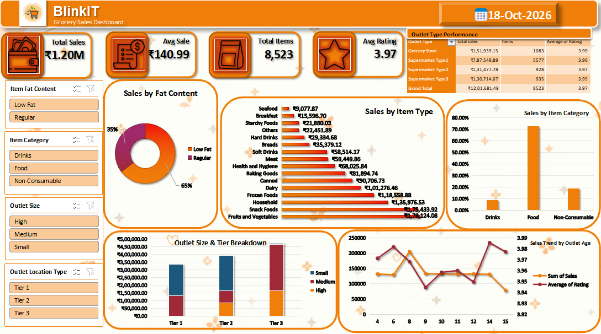

# Blinkit-Grocery-Sales-Analysis
Blinkit Grocery Sales Analysis Dashboard built using Excel WPS Spreadsheets.
# Blinkit Grocery Sales Analysis Dashboard

An end-to-end data analytics project evaluating 8,523 grocery transactions across 10 quick-commerce dark stores/outlets. This project covers systematic data auditing, categorical cleaning, multi-dimensional Pivot Table modeling, and an interactive executive dashboard built entirely in spreadsheets.

---

## 📊 Dashboard Preview



---

## 📌 Project Overview

Project Name: Blinkit Grocery Sales Analysis Dashboard
Tool Used: WPS Spreadsheets / Microsoft Excel
Project Type: Data Cleaning, Data Analysis, Business Intelligence and Dashboard Reporting
Dataset Size: 8,523 rows and 12 columns

---

## 🎯 Key Performance Indicators (KPIs)

- Total Sales: ₹12,01,681.49
- Average Sales: ₹140.99
- Total Item Records: 8,523
- Average Rating: 3.97

---

## 🛠️ Data Cleaning & Preparation

- Checked all 12 columns for duplicate records using the Remove Duplicates feature (0 duplicates found).
- Standardized inconsistent Item Fat Content entries into Low Fat and Regular categories using Find & Replace.
- Checked the dataset for missing values and identified 1,463 blanks in the Item Weight column.
- Retained missing Item Weight values because this column was not required for the main sales and outlet performance analysis.
- Reviewed data types and verified numerical values for aggregations.

---

## 🔍 Key Business Insights

- Fruits and Vegetables recorded the highest sales at ₹1,78,124.08, followed by Snack Foods at ₹1,75,433.92. Seafood recorded the lowest sales at ₹9,077.87.
- Tier 3 outlets recorded the highest sales at ₹4,72,133.03, followed by Tier 2 at ₹3,93,150.65 and Tier 1 at ₹3,36,397.81.
- Medium-size outlets recorded the highest sales at ₹5,07,895.74, followed by Small outlets at ₹4,44,794.17. High-size outlets recorded ₹2,48,991.59.
- Supermarket Type 1 recorded the highest sales at ₹7,87,549.89 among the four outlet types.
- Low Fat products accounted for 64.60% of the sales share, while Regular products accounted for 35.40%.
- Grocery Stores recorded the highest average rating of 3.99, while Supermarket Type 3 recorded 3.95. The overall average rating was 3.97.

---

## 💡 Business Recommendations

- Monitor stock availability for high-sales product categories (Fruits & Vegetables, Snack Foods).
- Review the sales performance of Tier 3 outlets to replicate best practices in other locations.
- Evaluate the operating practices of Medium-size outlets and compare them with Small and High-size outlets.
- Study the sales drivers of Supermarket Type 1 for cross-store operational improvements.
- Continue tracking Low Fat and Regular product sales to support stock planning decisions.
- Investigate rating differences across outlet types and improve customer satisfaction in Supermarket Type 3.

---

## 📁 Repository Structure

```text
├── BlinkIT-Grocery-cleaned-Data.xlsx   # Complete Excel workbook
├── BlinkIT-Grocery-Data.csv           # Raw transactional dataset
├── blinkit.png                        # Dashboard screenshot
└── README.md                          # Project documentation
